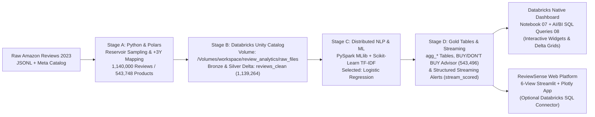

# ReviewSense Analytics — Scalable Product Review Sentiment & Buying Intelligence

**Course:** `23RAI351` – Big Data Analytics (End-Semester Project)  
**Faculty Guide:** Dr. Ravi Kumar V.  
**Team No. 1:** Sreenidhi and Lakshya Yarlagadda  
**Repository:** [Lakshya-dot/Product-Review-BigData-Analytics](https://github.com/Lakshya-dot/Product-Review-BigData-Analytics)  

---

## Overview

**ReviewSense Analytics** is an end-to-end Big Data NLP lakehouse and consumer buying decision platform built on **1,140,000 genuine Amazon Reviews 2023 records** (**1,139,264** after Spark/Polars cleaning & deduplication) spanning **543,496 unique products** (`parent_asin`) across **6 product categories** and **4 yearly cohorts (2023–2026)**.

The project integrates **both** a distributed **Databricks Delta Lakehouse & PySpark MLlib** analytics platform and a **6-view Streamlit + Plotly** interactive web application:

1. **Large-Scale Data Engineering (Python + Polars + PyArrow):** Inspects multi-gigabyte raw JSONL logs, performs reservoir sampling across 4 yearly cohorts, joins catalog attributes (`meta_*.jsonl`), and validates 100% genuine provenance (`is_synthetic = False`) within laptop RAM limits.
2. **Databricks Unity Catalog, Delta Lake & PySpark (`Data_Bricks(files)/`):** Runs Notebooks `01`–`07` on Databricks Serverless compute inside `workspace.review_analytics` — ingesting raw Parquet into managed Delta tables, running regex + negation-preserving NLP preprocessing, training distributed PySpark MLlib classifiers (`LogisticRegression`, `NaiveBayes`, `RandomForestClassifier`), producing Gold analytics tables, scoring products (`BUY` / `DON'T BUY`), simulating Spark Structured Streaming micro-batches, and powering a live interactive **Databricks Native Dashboard**.
3. **Explainable Buying Advisor (`parent_asin` Level):** Combines rating sentiment, ML-predicted positive share, scaled rating, recent-year score, multi-year trend, cross-year consistency, and negative complaint inversion into a transparent `0–100` BUY score.
4. **6-View Interactive Web Application (`dashboard/`):** Midnight Carbon theme with optional live Databricks SQL Warehouse connectivity (`DATABRICKS_HOST`, `DATABRICKS_HTTP_PATH`, `DATABRICKS_TOKEN`) and resilient local Gold Parquet fallback.

---

## End-to-End Architecture



---

## Dataset Design & Provenance

- **Source:** [McAuley Lab Amazon Reviews 2023](https://huggingface.co/datasets/McAuley-Lab/Amazon-Reviews-2023) (`raw/review_categories/` + `raw/meta_categories/`).
- **6 Categories:** `Electronics`, `Home and Kitchen`, `Health and Household`, `Beauty and Personal Care`, `Sports and Outdoors`, and `Books`.
- **Temporal Prototype Mapping (`+3 Year Shift`):** Because Amazon Reviews 2023 ends around September 2023, genuine 2020–2023 reviews were shifted forward by exactly 3 years (`2020 -> 2023`, `2021 -> 2024`, `2022 -> 2025`, `2023 -> 2026`), preserving real text, ratings, seasonal spikes, `original_timestamp`, `date_shifted = True`, and **`is_synthetic = False`** (0% synthetic records).
- **Rating-Derived Sentiment Labels:** `1–2 Stars -> Negative (0)`, `3 Stars -> Neutral (1)`, `4–5 Stars -> Positive (2)`.
- **Variant Grouping:** Products are grouped strictly by Amazon `parent_asin` so color/size variations stay consolidated under one canonical product entry.

### Yearly Cohort Breakdown (`results/year_summary.csv` & `workspace.review_analytics.agg_year_summary`)

| Year | Source Year | Cleaned Reviews | Positive % | Neutral % | Negative % | Avg Rating |
|---|---|---:|---:|---:|---:|---:|
| **2023** | 2020 | 219,790 | 79.20% | 6.41% | 14.39% | 4.24 |
| **2024** | 2021 | 259,807 | 76.00% | 6.93% | 17.07% | 4.13 |
| **2025** | 2022 | 309,846 | 74.34% | 7.22% | 18.44% | 4.07 |
| **2026** | 2023 (Jan–Sep) | 349,821 | 75.59% | 6.97% | 17.45% | 4.10 |
| **All** | 2020–2023 | **1,139,264** | **76.04%** | **6.92%** | **17.04%** | **4.12** |

---

## 5-Stage / 15-Phase Execution & Team Ownership

| Stage | Phases | Owner | Scope & Deliverables | Key Files |
|---|---|---|---|---|
| **A. Data Engineering** | 1–4 | Sreenidhi | Inspect raw JSONL files, reservoir-sample 4 yearly datasets, join `meta_*.jsonl` catalog details, validate schema/integrity rules | `scripts/inspect_dataset.py`, `scripts/build_yearly_datasets.py`, `scripts/add_product_info.py`, `scripts/validate_datasets.py` |
| **B. Databricks Lakehouse** | 5–6 | Sreenidhi | Upload Parquet datasets to Unity Catalog Volumes, create Delta tables (`reviews_all`, `products`), clean text & label (`reviews_clean`) | `Data_Bricks(files)/01_setup_and_load.ipynb`, `Data_Bricks(files)/02_clean_and_label.ipynb` |
| **C. Distributed NLP & ML** | 7–8 | Sreenidhi | Deterministic 80/20 `review_id` split, negation-preserving tokenization, TF-IDF vectorization, Logistic Regression vs. Naive Bayes vs. Random Forest | `Data_Bricks(files)/03_train_models.py`, `scripts/build_local_gold.py` |
| **D. Gold Analytics, Advisor & Streaming** | 9–12 | Lakshya Yarlagadda | Batch Gold tables (`reviews_scored`, `agg_*`), lift (`> 1.3`) keywords, 9 complaint themes, 7-factor `BUY`/`DON'T BUY` advisor (`543,496` products), Spark Structured Streaming alerts (`stream_scored`) | `Data_Bricks(files)/04_historical_analytics.py`, `05_search_and_recommend.py`, `06_streaming_reviews.py` |
| **E. Dual Dashboards & Scaling** | 13–15 | Lakshya Yarlagadda | Native interactive **Databricks Dashboard** (`07` + SQL `08`), 6-view Midnight Carbon **ReviewSense Streamlit App**, live Databricks SQL Warehouse connector, 16-run partition scalability benchmark, documentation | `Data_Bricks(files)/07_databricks_dashboard.py`, `08_databricks_sql_queries.sql`, `dashboard/*` |

---

## Databricks Lakehouse Execution (`workspace.review_analytics`)

All notebooks `01` through `07` have been executed end-to-end on Databricks Free Edition Serverless compute.

### Verified Unity Catalog Delta Tables

| Delta Table | Row Count | Stage / Purpose |
|---|---:|---|
| `reviews_2023` / `2024` / `2025` / `2026` | 220K / 260K / 310K / 350K | Raw yearly Bronze Delta ingestion from `/Volumes/workspace/review_analytics/raw_files` |
| `reviews_all` / `products` | 1,140,000 / 543,748 | Combined Bronze review log & product catalog |
| `reviews_clean` / `reviews_scored` | 1,139,264 / 1,139,264 | Cleaned, deduplicated & ML-scored Silver/Gold reviews |
| `agg_year_summary` / `agg_year_category` | 5 / 24 | Executive KPI rollups by year and category |
| `agg_monthly` / `agg_brand` / `agg_product_year` | 258 / 3,955 / 709,300 | Time-series trends, brand scorecards & annual product rollups |
| `agg_top_words` / `agg_complaints` / `model_metrics` | 750 / 216 / 3 | Distinctive words (`lift > 1.3`), complaint themes & MLlib evaluation log |
| `product_recommendations` | 543,496 | Explainable verdicts (`BUY`: `3,074`, `DON'T BUY`: `1,220`, `INSUFFICIENT DATA`: `539,202` in Databricks) |
| `stream_scored` | 999 | Spark Structured Streaming micro-batch output + negative alerts |

---

## ML Model Benchmarks

### 1. Databricks Distributed PySpark MLlib (`03_train_models.py` — 912,260 Train Rows)

| Model | Status | Accuracy | Macro F1 | Weighted F1 | Neg Recall | Neu Recall | Pos Recall | Train Time |
|---|---|---:|---:|---:|---:|---:|---:|---:|
| **`logistic_regression`** | **Selected Best** | **82.53%** | **0.6644** | **0.8466** | **74.64%** | 51.40% | **87.12%** | 27.71s |
| `naive_bayes` | Baseline | 77.69% | 0.6174 | — | — | — | — | — |
| `random_forest` | Baseline | 75.46% | 0.5866 | — | — | — | — | — |

Best Spark MLlib model pipeline saved to `/Volumes/workspace/review_analytics/models/best_sentiment_model`.

### 2. Local Edge Inference Benchmark (`results/model_metrics.csv` — 911,272 Train / 227,992 Test Rows)

Using TF-IDF (`max_features=80,000`, `ngram_range=(1, 2)`, `min_df=5`, balanced class weights) powering instant live prediction in the Streamlit web UI:

| Model | Status | Accuracy | Macro F1 | Weighted F1 | Neg Recall | Neu Recall | Pos Recall | Train Rows |
|---|---|---:|---:|---:|---:|---:|---:|---:|
| **Logistic Regression** | **Selected** | 79.97% | **0.6601** | 0.8323 | **74.34%** | 61.49% | 82.93% | 911,272 |
| **Naive Bayes** | Baseline | **80.05%** | 0.6597 | **0.8335** | 73.87% | **62.73%** | **83.02%** | 911,272 |
| **Random Forest** | Baseline | 77.28% | 0.6025 | 0.7965 | 67.78% | 42.52% | 82.59% | 150,000 |

---

## Explainable BUY / DON'T BUY Scoring Formula

Every product (`parent_asin`) receives a weighted `0–100` composite score:
- **20%** Rating-based Positive % (`4–5` stars)
- **15%** ML-Predicted Positive %
- **20%** Average Rating scaled (`(avg_rating - 1) / 4 * 100`)
- **15%** Recent-Year Positive %
- **10%** Year-over-Year Sentiment Trend (`recent_year - first_year`)
- **10%** Cross-Year Consistency (`100 - 2 * std`)
- **10%** Complaint Inversion (`100 - negative_pct`)

**Decision Rules:**
- `< 20` reviews → **`INSUFFICIENT DATA`** (`539,202` products)
- `>= 20` reviews & score `>= 65` → **`BUY`** (`3,018` local Gold / `3,074` Databricks MLlib)
- `>= 20` reviews & score `< 65` → **`DON'T BUY`** (`1,276` local Gold / `1,220` Databricks MLlib)

---

## 16-Run Scalability Benchmark (`results/scalability_benchmark_16_runs.csv`)

Measured across 4 dataset scales (`10,000`, `100,000`, `250,000`, `500,000` reviews) × 4 partition counts (`2`, `4`, `8`, `16`):
- **500,000 reviews @ 2 partitions:** `77.68s` (`6,436.3 rev/s`)
- **500,000 reviews @ 4 partitions:** `70.04s` (`7,139.2 rev/s`)
- **500,000 reviews @ 8 partitions:** `81.32s` (`6,148.3 rev/s`)
- **500,000 reviews @ 16 partitions:** **`55.44s`** (**`9,019.1 rev/s`** — fastest 500K runtime; peak overall `9,039.9 rev/s` at 10K @ 2 partitions)

---

## Interactive Dashboards Included

### A. Databricks Native Dashboard (`Data_Bricks(files)/07_databricks_dashboard.py` & `08_databricks_sql_queries.sql`)
- **4 Live Interactive Widgets:** `1. Year`, `2. Category`, `3. Product Search`, `4. Verdict Filter`.
- **12 Self-Contained Dashboard Tiles:** Executive KPI scorecard, 4-year stacked sentiment trajectory, category comparison across 4 years, monthly sentiment trend, 1–5 star distribution, customer complaint themes, top distinctive Positive & Negative words (lift > 1.3), PySpark MLlib benchmark chart + metrics table, live `product_recommendations` search table, and `stream_scored` summary + negative alert monitor.
- Uses crisp single-output-per-cell Matplotlib PNG visuals (`dpi=130`, Midnight Carbon theme) + native Databricks `display()` grids for zero-error rendering in **Focus/Present** mode.

### B. 6-View Streamlit Website (`dashboard/views/`)
1. **Home (`home.py`):** Overview hero, instant product buying search, live KPIs, high-volume `BUY` vs. `DON'T BUY` catalog picks, and module directory.
2. **Market Analytics (`historical.py`):** Year & category filters, Avg Rating + Sentiment Mix trajectory, grouped/heatmap category comparison, star rating distribution, monthly trends, word lift butterfly chart, complaint heatmap, brand leaderboard scatter, and architecture summary.
3. **Buying Advisor (`search.py`):** Search 543,496 products by keyword, brand, category, verdict, confidence, and price ceiling; inspect BUY Score gauge, 7-factor breakdown, aspect sentiment, complaints, lazy-loaded specifications, review quotes, and **Side-by-Side 6-Axis Radar Comparison**.
4. **ML & Review Checker (`ml_models.py`):** Model comparison table & radar, confusion matrix, TF-IDF polarity butterfly, live **Compare Both** token-level predictor, and **Batch CSV Scorer**.
5. **Live Stream (`streaming.py`):** Micro-batch stream simulator over 5,000 held-out 2026 reviews with live positive pulse gauge, rolling chart, `NEGATIVE ALERT` cards, and CSV export.
6. **Scalability & Scope (`scalability.py`):** 16-run runtime curves, throughput & speedup heatmaps, stage time breakdown, and limitations & future roadmap.

---

## Repository Structure

```text
Product-Review-BigData-Analytics/
├── .streamlit/config.toml                      # Midnight Carbon dark theme
├── requirements.txt                            # Python dependencies (local & Streamlit Cloud)
├── requirements_dashboard.txt                  # Dashboard dependency list
├── run_dashboard.bat / run_dashboard.ps1       # Local & same-Wi-Fi launchers
├── share_public_link.bat                       # Public HTTPS tunnel launcher (Cloudflare)
├── VIVA_PREPARATION_GUIDE.md                   # End-semester demo script, catalog & viva Q&A
├── Data_Bricks(files)/
│   ├── 01_setup_and_load.ipynb                 # Unity Catalog schema, volume & Bronze Delta tables
│   ├── 02_clean_and_label.ipynb                # Spark cleaning, deduplication & proxy labels
│   ├── 03_train_models.py                      # PySpark MLlib TF-IDF + 3-model benchmark
│   ├── 04_historical_analytics.py              # Batch Gold summary & complaint tables
│   ├── 05_search_and_recommend.py              # Weighted BUY / DON'T BUY scoring & search demo
│   ├── 06_streaming_reviews.py                 # Spark Structured Streaming micro-batch monitor
│   ├── 07_databricks_dashboard.py              # Interactive Databricks Dashboard (Widgets + Charts)
│   ├── 08_databricks_sql_queries.sql           # 9 SQL datasets for Databricks AI/BI Dashboards
│   └── DATABRICKS_DASHBOARD_GUIDE.md           # Step-by-step Databricks execution & SQL guide
├── scripts/                                    # Data engineering & build_local_gold.py
├── models/                                     # Fitted TF-IDF, Logistic Regression & Naive Bayes (.joblib)
├── results/                                    # Exported CSV tables for report & slides
├── data/gold/
│   ├── *.parquet                               # Aggregated Gold tables & stream pool
│   └── product_recommendations_shards/         # 4 zstd Parquet shards (<49 MB each, 543,496 products)
└── dashboard/
    ├── app.py                                  # Top-navbar st.navigation router
    ├── utils.py                                # Theme, lazy shard loader, ML & optional Databricks SQL connector
    └── views/                                  # home.py, historical.py, search.py, ml_models.py, streaming.py, scalability.py
```

---

## Quick Start

### 1. Run Locally (Streamlit Website)
```bash
git clone https://github.com/Lakshya-dot/Product-Review-BigData-Analytics.git
cd Product-Review-BigData-Analytics
pip install -r requirements.txt
streamlit run dashboard/app.py
```
On Windows with the included launchers:
- **Local / Same-Wi-Fi:** Double-click `run_dashboard.bat` and open `http://localhost:8501`.
- **Public Shareable Link:** Double-click `share_public_link.bat` (requires `tools\cloudflared.exe`) to generate an instant `https://*.trycloudflare.com` URL.

### 2. Deploy 24/7 on Streamlit Community Cloud
1. Open **[share.streamlit.io](https://share.streamlit.io)** and sign in with GitHub (`Lakshya-dot`).
2. Select repository **`Lakshya-dot/Product-Review-BigData-Analytics`**, branch **`main`**, and main file path **`dashboard/app.py`**.
3. Click **Deploy**. All Gold tables, sharded product recommendations, and fitted ML models are already committed cleanly.

---

## Limitations & Future Enhancements

- **Proxy Labels:** Labels are derived from 1–5 star ratings rather than manual sentiment annotation.
- **Sarcasm & Context:** Bag-of-words TF-IDF struggles with subtle sarcasm; upgrading to fine-tuned transformers (DistilBERT/RoBERTa) is planned.
- **Compute Environment:** Built on Databricks Free Edition + single-node workstation; deploying on a multi-node Spark cluster with Kafka ingestion is the natural production extension.
